<h1>I build tools for coding harnesses.</h1>

Most of my client work and product development happens in private. In public, I contribute to <a href="https://github.com/Get-Concord-AI/concord-mcp">Concord MCP</a>, to help developers coordinate work across coding harnesses.

<h2>Open source contributions</h2>

<strong>Concord MCP</strong> · Selected merged pull requests

<ul>
<li><a href="https://github.com/Get-Concord-AI/concord-mcp/pull/412"><strong>Keep custom settings on reinstall</strong></a> · <code>#412</code> The Concord installer now preserves timeouts, disabled flags and other client settings.</li>
<li><a href="https://github.com/Get-Concord-AI/concord-mcp/pull/404"><strong>Connect coding harnesses across worktrees</strong></a> · <code>#404</code> I documented how Claude Code, Codex and OpenCode share a Concord workspace in T3 Code.</li>
</ul>

<a href="https://github.com/Get-Concord-AI/concord-mcp/pulls?q=is%3Apr+author%3Ajseramn">See all my Concord pull requests →</a>

<h2>Harnesses in my workflow</h2>

<strong>9 active harnesses</strong> · Monthly tokens · November 2026

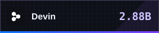
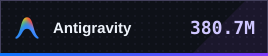
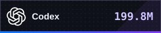
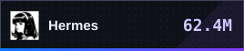
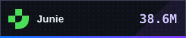
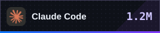
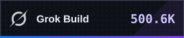
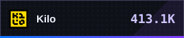
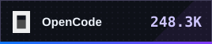

<h2>Models in my workflow</h2>

<strong>30 identified models</strong> · Monthly tokens · November 2026

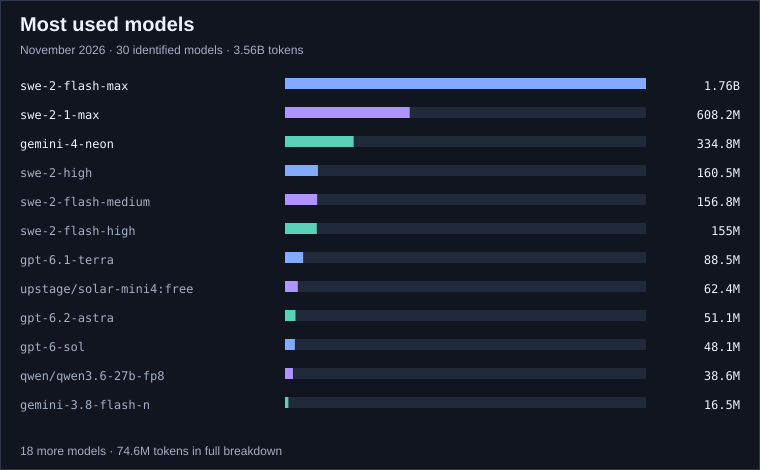

Explore all 30 models

Usage data from <a href="https://github.com/Javis603/token-monitor">Token Monitor</a> · 27 Nov 2026, 06:03 UTC

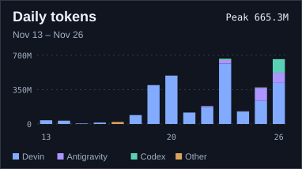
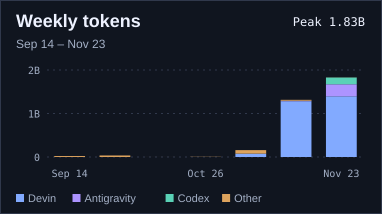
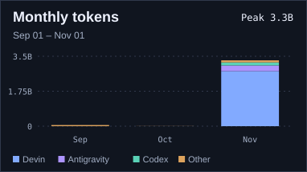

Show estimated costs · daily, weekly and monthly

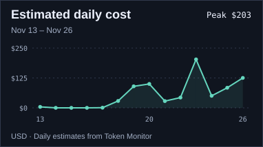
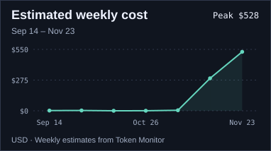
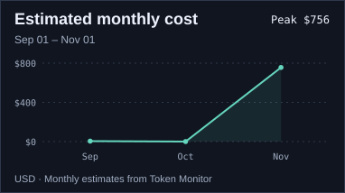

Activity calendar and token totals

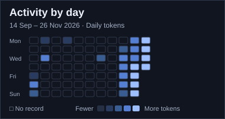

25.8M today · 3.57B this month · 3.63B all time

<h2>Toolbox</h2>

Explore my languages, stack and tools

<strong>Languages</strong>

  
  
  
  
  
  
  
  

<strong>Stack</strong>

  
  
  
  
  
  
  
  
  
  
  
  
  
  
  
  
  
  
  
  

<strong>Harnesses</strong>

  
  
  
  
  
  
  
  
  
  
  
  
  
  
  
  
  
  
  
  

<strong>Workshop</strong>

  
  
  
  
  
  
  
  
  

<strong>Daily</strong>

  
  
  
  
  
  
  
  
  
  
  
  

